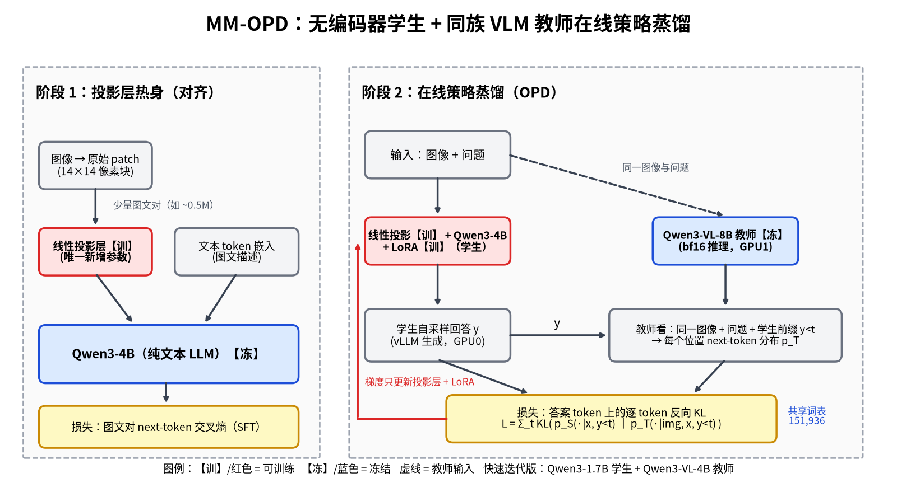

# mm-opd

mm-opd 研究如何让纯文本 LLM 在不加 ViT/SigLIP 的情况下获得原生多模态能力：原始图像 patch 经线性层或浅层 MLP 进入文本 LLM（Fuyu/EVE 式 encoder-free），训练用同族 VLM 教师的 on-policy distillation，而不是大规模 SFT。研究计划见 `plan.md`。方法见下图（`figures/mm_opd_method.png`，作图脚本 `figures/make_method_figure.py`）；2×L20 上的词表核对、模型选择与显存估算见 `docs/compute.md`。已公布基准只作引用，见 `docs/bench_baselines.md`。演示设定下的假设目标见 `docs/expected_results.md` 与 `figures/expected_results_table.png`，那些红字不是实验结果。`src/mm_opd` 里是骨架，预热和 OPD 训练入口还没实现，仓库里没有实验结果。

## 快速开始

Python 3.11，用 uv 管理。PyTorch 从 CUDA 12.8 的官方 wheel 索引（`cu128`）安装，这是目前仍在更新的 cu12 线。

```bash
uv sync
uv run python scripts/check_tokenizer.py
```

`scripts/check_tokenizer.py` 用学生和教师的 tokenizer 编码同一批文本并比较 token id，只下载 tokenizer，不下载权重。默认对应 `configs/small_1p7b.yaml`（Qwen3-1.7B 与 Qwen3-VL-4B-Instruct）。主配置：

```bash
uv run python scripts/check_tokenizer.py \
  --student Qwen/Qwen3-4B \
  --teacher Qwen/Qwen3-VL-8B-Instruct
```

可选依赖：`uv sync --extra deepspeed`；文本评测 `uv sync --extra eval`（安装 lm-eval）。数据下载见 `data/README.md`。多模态入口 `scripts/eval_mm.sh` 在模型适配器接上之前不会打分。文本入口是 `scripts/eval_text.sh`。


