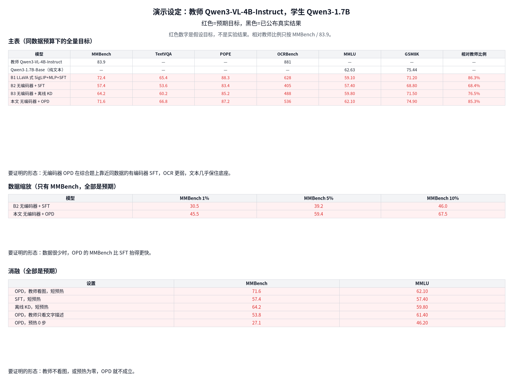

# 预期结果（演示设定）

红色数字是假设目标，用来对照 `plan.md` 第 6 节，不是已经跑出来的结果。黑色数字只来自 `docs/bench_baselines.md` 里已公布的成绩。图 `figures/expected_results_table.png`（脚本 `figures/make_expected_results_table.py`）用同一套数：红色是预期目标，黑色是已公布真实结果。

演示设定是小配置：教师 Qwen3-VL-4B-Instruct，学生 Qwen3-1.7B。主表的「相对教师比例」只按 MMBench / 83.9。教师的 TextVQA 和 POPE 未公布，这里不补，也不拿它们凑宏平均。等这两项测到教师分数之后，希望 MMBench、TextVQA、POPE 的宏平均落在教师的 80%–90%。

已公布、本表拿来当锚的数：教师 MMBench-EN（V1.1）83.9、MMMU 67.4、OCRBench 881；Qwen3-1.7B-Base 的 MMLU 62.63（5-shot）、GSM8K 75.44（4-shot CoT）。Instruct 的 MMLU 原版和 GSM8K 未公布，所以文本目标对着 Base。无编码器参照：EVEv2-7B 的 MMBench 66.3、TextVQA 71.1、OCRBench 702；Mono-InternVL-2B 的 MMBench 65.5、TextVQA 72.6、OCRBench 767。MMBench 的目标可以高于 66.3 和 65.5，因为教师本身是 83.9。OCR 和 TextVQA 的目标停在这两条已公布成绩之下。

## 主表

| 模型 | MMBench | TextVQA | POPE | OCRBench | MMLU | GSM8K | 相对教师比例 | 性质 |
|---|---|---|---|---|---|---|---|---|
| 教师 Qwen3-VL-4B-Instruct | 83.9 | — | — | 881 | — | — | — | 已公布 |
| Qwen3-1.7B-Base（纯文本） | — | — | — | — | 62.63 | 75.44 | — | 已公布 |
| B1 LLaVA 式 SigLIP+MLP+SFT | 72.4 | 65.4 | 88.3 | 628 | 59.10 | 71.20 | 86.3% | 预期 |
| B2 无编码器 + SFT | 57.4 | 53.6 | 83.4 | 405 | 57.40 | 68.80 | 68.4% | 预期 |
| B3 无编码器 + 离线 KD | 64.2 | 60.2 | 85.2 | 488 | 59.80 | 71.50 | 76.5% | 预期 |
| 本文 无编码器 + OPD | 71.6 | 66.8 | 87.2 | 536 | 62.10 | 74.90 | 85.3% | 预期 |

空缺是未公布或纯文本模型没有的多模态分，不是零分。B1–B3 和本文四行都是同数据预算下的全量目标。本文在无编码器三行里最好：MMBench 为教师的 85.3%，TextVQA 略高于 B1，POPE 接近 B1，OCRBench 低于 B1，也低于 EVEv2-7B 的 702 和 Mono-InternVL-2B 的 767。MMLU、GSM8K 距 Base 都在 1 分以内；B2 则大约掉 5.2 分和 6.6 分。

要证明的形态：无编码器 OPD 在综合题上靠近同数据的有编码器 SFT，OCR 更弱，文本几乎保住底座。

## 数据缩放

只看 MMBench。1%、5%、10% 都是预期，没有已公布对照。

| 模型 | 1% | 5% | 10% |
|---|---|---|---|
| B2 无编码器 + SFT | 30.5 | 39.2 | 46.0 |
| 本文 无编码器 + OPD | 45.5 | 59.4 | 67.5 |

67.5 / 83.9 = 80.5%。1% 的 45.5 仍低于 EVE-7B（HD）已公布的 MMBench 52.3，10% 才进入教师的 80%，并略高于全量离线 KD 的目标 64.2。全量目标是 B2 57.4、本文 71.6，曲线单调，不在低数据处写满。

要证明的形态：数据很少时，OPD 的 MMBench 比 SFT 抬得更快。

## 消融

全部是预期。MMBench 与主表里的同名设置用同一个目标，避免一张图里两套数。

| 设置 | MMBench | MMLU |
|---|---|---|
| OPD，教师看图，短预热 | 71.6 | 62.10 |
| SFT，短预热 | 57.4 | 57.40 |
| 离线 KD，短预热 | 64.2 | 59.80 |
| OPD，教师只看文字描述 | 53.8 | 61.40 |
| OPD，预热 0 步 | 27.1 | 46.20 |

教师只看文字描述时，MMBench 低于 SFT，MMLU 仍接近底座。预热为 0 时 MMBench 落在四选一的随机附近，MMLU 也明显垮掉。

要证明的形态：教师不看图，或预热为零，OPD 就不成立。

